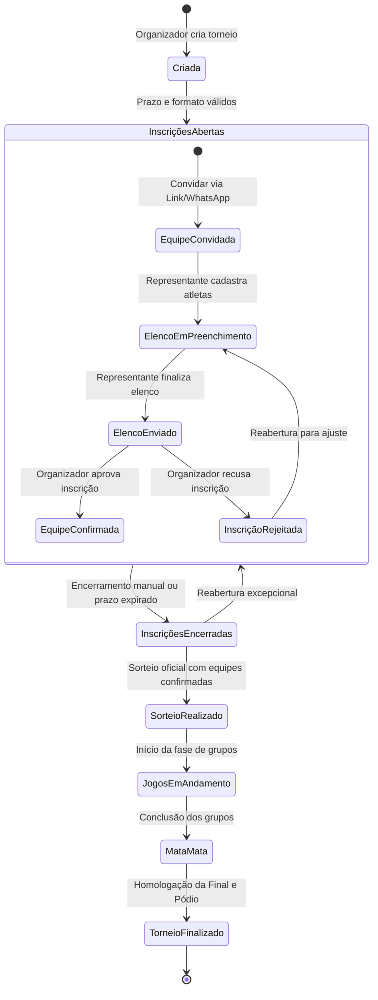

# BASEOS — RELATÓRIO TÉCNICO DE AUDITORIA — FASE 8.2
# PARTE 2: FECHAMENTO, SORTEIO, GESTOR/AUTH, PENDÊNCIAS, INVARIANTES E CONTRATO FASE 8.3
*(Seções 14 a 28 do Modelo Funcional da Competição)*

> **Documento complementar:** Consulte a [Parte 1 (Seções 1 a 13)](file:///home/diego-martins/docker/volei/docs/audits/FASE-8.2-MODELO-FUNCIONAL-COMPETICAO-INSCRICAO-PARTE-1.md) para Objetivo, Diagnóstico, Lifecycle, Gestão de Vagas, Team vs CompetitionTeam, Convite, Inscrição e Pagamento.
> **Diretriz Mandatória:** NO CODE BEFORE CONTRACT
> **Status:** `FUNCTIONAL MODEL DEFINED`

---

## 14. FECHAMENTO DAS INSCRIÇÕES

O fechamento formal das inscrições (`registration-closed`) encerra o período de captação de agremiações:

- **Efeitos do Fechamento:**
  1. Todos os links públicos com token passam a exibir a mensagem: *"Inscrições encerradas pela organização. Edição de elenco bloqueada."*
  2. A flag `is_locked` de todas as equipes inscritas é definida como `true`.
  3. Equipes que permaneceram em `invited` ou `in_progress` sem enviar elenco são marcadas como inaptas para o sorteio.
  4. O painel do organizador habilita o botão de destaque **"Avançar para o Sorteio Oficial"**.

---

## 15. RELAÇÃO COM O SORTEIO DAS CHAVES

### Critério Sagrado de Elegibilidade para o Sorteio
> **SOMENTE EQUIPES COM STATUS `approved` (CONFIRMADAS) E ELENCO MÍNIMO REGULAMENTAR SÃO ELEGÍVEIS PARA O SORTEIO.**

- Equipes em `invited`, `in_progress`, `submitted` (sem aprovação) ou `rejected` **NÃO ENTRAM NA URNA**.
- O motor de sorteio (`runDraw` em `src/services/drawService.ts`) recebe única e exclusivamente a lista filtrada por:
  ```typescript
  const eligibleTeams = registrations.filter(
    r => r.status === 'approved' && !r.isLocked && athleteCount >= minAthletes
  );
  ```
- O sorteio exige um quórum mínimo de **2 equipes confirmadas**.
- Ao salvar o sorteio oficial, a competição transita automaticamente para `groups-defined` e a grade de confrontos da fase de grupos é gerada de forma atômica.

---

## 16. RELAÇÃO COM O CADASTRO DE ATLETAS

### Regras de Elenco e Elegibilidade Individual:
1. **Momento de Cadastro:** O representante pode adicionar atletas a partir do momento em que recebe o link de convite (`invited`).
2. **Bloqueio de Elenco:** O elenco só pode ser alterado enquanto `is_locked === false` e dentro do prazo regulamentar (`registrationDeadline`).
3. **Prorrogação Individual:** O organizador pode prorrogar o prazo de uma equipe individualmente através da ação **"Prorrogar"** em `CompetitionRegistrationsPage.tsx`, sem precisar reabrir as inscrições de todo o campeonato.
4. **Proteção Contra Atleta Biparte (Unicidade no Torneio):** O `CompetitionRegistrationService` já implementa a checagem: um atleta com mesmo documento não pode ser cadastrado em duas equipes diferentes na mesma competição.

---

## 17. ARQUITETURA DO ACESSO DO GESTOR DA EQUIPE (AUTH)

A Fase 8.1 determinou a remoção imediata da senha em texto puro (`managerPassword`) de `teams`. A arquitetura funcional de acesso segue 2 níveis:

```text
                    [ FLUXO DE ACESSO DO GESTOR ]
                                  │
         ┌────────────────────────┴────────────────────────┐
         ▼                                                 ▼
[ NÍVEL 1: ACESSO POR TOKEN ]             [ NÍVEL 2: CONTA SUPABASE AUTH ]
- Link exclusivo: /equipe/inscricao/:token  - Usuário cria conta oficial (E-mail/Senha)
- Sessão pública ancorada no token          - auth.users (criptografia nativa segura)
- Ideal para agilidade e envio via WhatsApp - public.profiles.competition_team_id
- Permite gerenciar atletas e ver jogos     - Acesso ao painel completo de clubes
```

- **Invariante de Segurança:** Nenhuma senha jamais será armazenada em `TeamRecord`, `CompetitionTeam`, `localStorage` ou enviada em texto puro via API.

---

## 18. CADASTRO MANUAL PELO ORGANIZADOR

Nem todos os torneios contam com representantes que utilizam links de WhatsApp. O organizador deve ter autonomia total:

- **Botão "Cadastrar Equipe":**
  - Permite ao organizador selecionar uma equipe da base global ou cadastrar uma nova.
  - Permite ao organizador cadastrar diretamente os atletas caso tenha recebido a ficha física de inscrição.
  - Permite marcar a equipe imediatamente como **Confirmada (`approved`)** no ato do cadastro, pulando as etapas de convite e pré-candidatura caso a inscrição tenha sido feita presencialmente na federação/liga.

---

## 19. CENTRAL DE PENDÊNCIAS (DASHBOARD DO ORGANIZADOR)

Para eliminar o estresse operacional antes do sorteio, o painel de inscrições deve exibir um bloco consolidado de **Pendências Críticas**:

```text
┌────────────────────────────────────────────────────────────────────────┐
│                        CENTRAL DE PENDÊNCIAS                           │
├────────────────────────────────────────────────────────────────────────┤
│ ⚠️  2 Equipes aguardando confirmação (Elenco finalizado enviado)       │
│ ⚠️  1 Equipe com elenco abaixo do mínimo (4/6 atletas)                 │
│ ⏰  3 Prazos de inscrição expirando nas próximas 24 horas              │
│ ℹ️  Vagas restantes: 4 de 16 vagas preenchidas                         │
└────────────────────────────────────────────────────────────────────────┘
```

Cada item da central de pendências conta com um botão de ação direta:
- *Ver Elenco para Aprovação*
- *Notificar Representante via WhatsApp*
- *Prorrogar Prazo*

---

## 20. CENTRAL DE AJUDA: DÚVIDAS REAIS DO ORGANIZADOR

A Central de Ajuda do BaseOS (`src/data/helpArticles.ts`) deve responder às perguntas em linguagem simples de voleibol e gestão esportiva:

1. **"Como criar uma competição e começar a receber equipes?"**
   > *Clique em Nova Competição, informe o nome, datas e prazo limite de inscrição. A competição já estará pronta para receber inscrições.*
2. **"Qual a diferença entre Convidar Equipe e Cadastrar Equipe?"**
   > *Convidar gera um link para o representante da equipe preencher o elenco no celular dele. Cadastrar equipe permite que você mesmo preencha os dados caso tenha a ficha em mãos.*
3. **"Quando uma equipe é considerada Confirmada e entra no sorteio?"**
   > *A equipe só entra no sorteio depois que enviar o elenco completo e você clicar no botão 'Confirmar Equipe' na tabela de inscrições.*
4. **"O que acontece se uma equipe enviar menos atletas que o mínimo permitido?"**
   > *O sistema bloqueia a elegibilidade para o sorteio e alerta que o elenco está incompleto.*
5. **"Como prorrogar o prazo de uma equipe sem reabrir todo o campeonato?"**
   > *Na tabela de inscrições, clique no botão 'Prorrogar' ao lado da equipe e escolha uma nova data.*

---

## 21. MÁQUINA DE ESTADOS FUNCIONAL



---

## 22. MATRIZ DE PERMISSÕES (RBAC)

| Ação Funcional | Organizador / Admin | Gestor de Equipe | Árbitro / Mesário | Público |
| :--- | :---: | :---: | :---: | :---: |
| Criar competição | Sim | Não | Não | Não |
| Convidar equipe | Sim | Não | Não | Não |
| Cadastrar equipe diretamente | Sim | Não | Não | Não |
| Editar dados do clube (logo/técnico) | Sim | Sim (sua equipe) | Não | Não |
| Cadastrar atletas no elenco | Sim | Sim (até trancar) | Não | Não |
| Finalizar envio do elenco (`submitted`) | Sim | Sim | Não | Não |
| Confirmar equipe no torneio (`approved`) | Sim | Não | Não | Não |
| Rejeitar inscrição (`rejected`) | Sim | Não | Não | Não |
| Prorrogar prazo individual | Sim | Não | Não | Não |
| Encerrar inscrições do campeonato | Sim | Não | Não | Não |
| Reabrir inscrições | Sim | Não | Não | Não |
| Executar e homologar sorteio | Sim | Não | Não | Não |
| Lançar súmula e placar | Sim | Não | Sim | Não |
| Visualizar tabelas, jogos e boletins | Sim | Sim | Sim | Sim |

---

## 23. TRILHA DE AUDITORIA E EVENTOS CRÍTICOS

Todos os atos de gestão esportiva devem registrar eventos imutáveis em `public.audit_logs` via `OperationalAuditService`:

- `competition.created`: Torneio criado com suas regras iniciais.
- `team.invited`: Convite de agremiação emitido com token.
- `team.roster_submitted`: Representante submeteu o elenco no portal online.
- `team.confirmed`: Organizador aprovou formalmente a participação da equipe.
- `team.rejected`: Inscrição rejeitada com justificativa registrada.
- `registration.deadline_extended`: Prazo de equipe prorrogado.
- `registration.closed`: Inscrições do torneio encerradas.
- `registration.reopened`: Inscrições reabertas excepcionalmente.
- `draw.homologated`: Sorteio oficial persistido e chaves travadas.
- `competition.started`: Início oficial das partidas.
- `competition.completed`: Pódio homologado e campeonato arquivado.

---

## 24. REGRAS DE INTEGRIDADE INVARIANTES DO BASEOS

1. **Invariante 1:** Nenhuma equipe com status diferente de `approved` pode entrar no sorteio de chaves.
2. **Invariante 2:** Nenhuma equipe com quantidade de atletas inferior ao mínimo regulamentar pode ser sorteada.
3. **Invariante 3:** Uma equipe confirmada ocupa exatamente 1 vaga na capacidade da competição.
4. **Invariante 4:** Uma agremiação global (`teams`) não pode ser inscrita mais de uma vez na mesma competição.
5. **Invariante 5:** O nome da equipe no torneio (`team_name`, `team_short_name`) é um snapshot imutável em `competition_teams`.
6. **Invariante 6:** Um atleta não pode defender duas equipes na mesma competição (unicidade por documento).
7. **Invariante 7:** O elenco só possui até 1 capitão e até 2 líberos (no vôlei de quadra).
8. **Invariante 8:** Senhas nunca são persistidas em `teams` ou `competition_teams`.
9. **Invariante 9:** O token de auto-inscrição é intransferível e único por inscrição.
10. **Invariante 10:** Competições com partidas já disputadas não podem ter suas inscrições reabertas nem seu regulamento alterado.
11. **Invariante 11:** O sorteio exige um quórum mínimo de 2 equipes confirmadas.
12. **Invariante 12:** Competições finalizadas ou canceladas tornam-se estritamente somente-leitura.

---

## 25. IDENTIFICAÇÃO E CLASSIFICAÇÃO DOS GAPS DE BANCO

| Necessidade Funcional | Status no Schema PostgreSQL 17.6 Real | Classificação | Diretriz para a Fase 8.3 |
| :--- | :--- | :--- | :--- |
| Criar Competição com Parâmetros Regulamentares | Tabela `competitions` possui coluna `config` (JSONB), mas UI enviava colunas inexistentes | **SUPPORTED (Ajustar Mapper)** | O mapper canônico colocará os campos top-level dentro de `config` |
| Cadastrar Equipe Global | Tabela `teams` possui colunas exatas (`name`, `short_name`, `modality`, `coach_name`, `city`, `logo_url`) | **SUPPORTED (Ajustar Mapper)** | Remover injeção cega de `managerPassword` e `state` |
| Vínculo Equipe-Competição | Tabela `competition_teams` possui colunas completas (`competition_id`, `team_id`, `access_token`, `status`, etc.) | **SUPPORTED** | Utilizar a estrutura existente |
| Aprovação/Confirmação de Equipe | Enum `public.registration_status` já contém `'approved'` e `'rejected'` | **SUPPORTED** | Adicionar botões e handlers na UI de inscrições |
| Controle de Taxa de Pagamento | `competition_teams` não possui colunas financeiras | **GAP — RESOLVIDO NA APLICAÇÃO** | Armazenar dados de confirmação financeira em `custom_notes` (JSON) |
| Capacidade Máxima de Equipes | `competitions` não possui coluna `max_teams` | **GAP — RESOLVIDO NA APLICAÇÃO** | Calcular a partir de `config.format` ou armazenar em `config.registration.maxTeams` |
| Gestão de Pessoas (`PersonRecord`) | Tabela `public.persons` não existe | **LEGACY** | Eliminar chamadas a `createPerson`; gestor é modelado via Supabase Auth + `profiles` |
| Tabela de Modalidades | Tabela `public.modalities` não existe (é enum `public.modality`) | **LEGACY** | Eliminar chamadas a `listModalities`; usar presets estáticos de domínio |

---

## 26. CONTRATO CANÔNICO DE IMPLEMENTAÇÃO DA FASE 8.3

A **Fase 8.3** implementará a solução com base nas seguintes especificações invioláveis:

### 26.1. Contrato de `Competition`
- **Criação:** Enviar para o PostgREST estritamente as colunas físicas de `public.competitions` (`name`, `modality`, `format`, `player_format`, `set_format`, `gender_category`, `status`, `config`, `venue`, `start_date`, `end_date`, `default_deadline`, etc.).
- **Regras:** Todo parâmetro esportivo (`groupsCount`, `advancingPerGroup`, `bestThirdsCount`, `scoring`, `tiebreakCriteriaOrder`, `phaseSetRules`) deve ser aninhado dentro de `config` (JSONB).

### 26.2. Contrato de `Team`
- **Criação:** Enviar para o PostgREST estritamente: `name`, `short_name`, `modality`, `coach_name`, `city`, `logo_url`.
- **Eliminação:** Remover definitivamente `managerPassword` do payload de equipes.

### 26.3. Contrato de `CompetitionTeam`
- **Ações na UI (`CompetitionRegistrationsPage.tsx`):**
  - Implementar o botão **"Confirmar Equipe"** (`updateCompetitionTeam(id, { status: 'approved' })`).
  - Implementar o botão **"Recusar Inscrição"** (`updateCompetitionTeam(id, { status: 'rejected' })`).
  - Implementar filtro e badge visual de pendências.
- **Elegibilidade para Sorteio:**
  - Atualizar `CompetitionDrawEligibilityService` para exigir estritamente `status === 'approved'`.

### 26.4. Tratamento de Erro no `supabaseAdapter`
- Substituir a supressão silenciosa de `{ error }` por asserções que propaguem exceções descritivas para a UI.

### 26.5. Mocks de Teste
- Ajustar os mocks do Vitest para rejeitar payloads com colunas inexistentes no schema do PostgreSQL.

---

## 27. MATRIZ DE IMPLEMENTAÇÃO DA FASE 8.3

| Item | Situação Atual | Comportamento Desejado na Fase 8.3 | Alteração Técnica Necessária | Fase |
| :--- | :--- | :--- | :--- | :---: |
| Botão "Criar Competição" | Quebrado (`PGRST204`) | Criação íntegra e abertura de inscrições | Mapper explícito + embutir campos em `config` | 8.3 |
| Botão "Cadastrar Equipe" | Quebrado (`PGRST204` / `PGRST205`) | Cadastro limpo da agremiação | Mapper explícito de `Team` + remoção de `managerPassword` | 8.3 |
| Confirmação de Equipe | Inexistente na UI | Organizador clica "Confirmar" e equipe é aprovada | Adicionar botões "Aprovar" / "Rejeitar" em `CompetitionRegistrationsPage` | 8.3 |
| Elegibilidade de Sorteio | Permissiva (aceita `invited`) | Sorteio restrito a equipes confirmadas | Atualizar `CompetitionDrawEligibilityService` para checar `status === 'approved'` | 8.3 |
| Ciclo de Vida da Competição | Rígido com 6 botões manuais | Fases fluidas com transições automáticas | Ajustar `CompetitionOverviewTab` e orquestrador de status | 8.3 |
| Erros de Persistência | Silenciados (retorna `null`) | Alertas claros e toast com erro | Desestruturar `{ error }` e disparar throw em `dataAccess.ts` | 8.3 |
| Testes Automatizados | Mocks aceitam qualquer payload | Mocks validam colunas reais | Reforçar `dataAccessAdapter.test.ts` com validação de schema | 8.3 |

---

## 28. CONCLUSÃO DA FASE 8.2

A **Fase 8.2** cumpriu com rigor todos os seus objetivos analíticos e conceituais, sem alterar uma única linha de código produtivo ou esquema de banco de dados (`NO CODE BEFORE CONTRACT`).

O BaseOS possui agora um modelo funcional maduro, robusto, auditável e perfeitamente orientado à experiência real do organizador esportivo. Todas as peças estão catalogadas para a execução da **Fase 8.3 — Implementação dos Mappers Canônicos, Correção dos Bloqueios P0 e Fluxo Operacional Homologado**.

**STATUS:** `FUNCTIONAL MODEL DEFINED`
