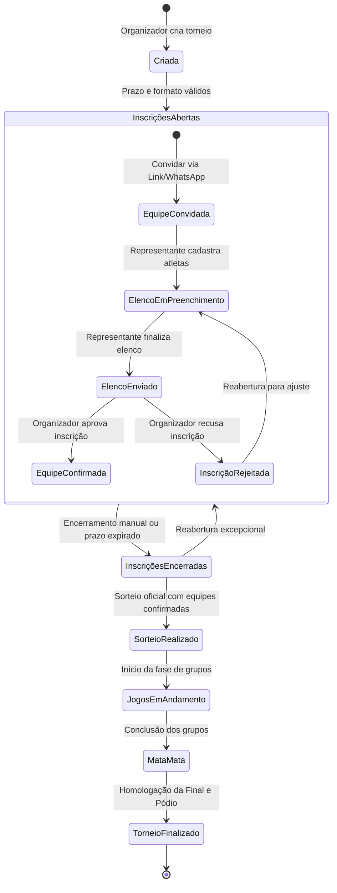

# BASEOS — RELATÓRIO TÉCNICO DE AUDITORIA — FASE 8.2
# MODELO FUNCIONAL DA COMPETIÇÃO, LIFECYCLE INTERNO E FLUXO DE INSCRIÇÃO/CONFIRMAÇÃO DE EQUIPES

> **Documento Canônico Oficial de Especificação Funcional do BaseOS**
> **Diretriz Mandatória:** NO CODE BEFORE CONTRACT
> **Status:** `FUNCTIONAL MODEL DEFINED`
>
> **Documentos particionados para análise facilitada:**
> - [Parte 1: Seções 1 a 13 (Objetivo, Diagnóstico, Lifecycle, Gestão de Vagas, Convite, Inscrição e Pagamento)](file:///home/diego-martins/docker/volei/docs/audits/FASE-8.2-MODELO-FUNCIONAL-COMPETICAO-INSCRICAO-PARTE-1.md)
> - [Parte 2: Seções 14 a 28 (Fechamento, Sorteio, Gestor/Auth, Pendências, Invariantes e Contrato Fase 8.3)](file:///home/diego-martins/docker/volei/docs/audits/FASE-8.2-MODELO-FUNCIONAL-COMPETICAO-INSCRICAO-PARTE-2.md)

---

## 1. OBJETIVO DA FASE 8.2

O objetivo da **Fase 8.2 do BaseOS** é definir e formalizar, com comprovação técnica e arquitetural, o **modelo funcional do produto** antes de qualquer implementação de código na Fase 8.3.

A Fase 8.1 mapeou o contrato real entre o modelo de domínio TypeScript e o banco de dados PostgreSQL 17.6 (`STATUS = CONTRACT MAPPED`), identificando falhas críticas (P0) nos botões de criação de competição e cadastro de equipe causadas pelo uso cego de `toSnake()`, ausência de tratamento de erro e tentativa de persistência de credenciais em entidades de domínio.

A finalidade desta Fase 8.2 é responder de forma definitiva e centrada no usuário:
> **Como uma pessoa real (organizador esportivo) cria uma competição, recebe equipes, analisa inscrições, gerencia capacidade/pagamentos, confirma agremiações, fecha inscrições, realiza o sorteio e inicia a competição sem precisar conhecer enums, migrações SQL ou a arquitetura interna do BaseOS?**

A complexidade operacional e de regras esportivas deve permanecer encapsulada no motor do BaseOS. A interface deve responder com clareza **"O que eu preciso fazer agora?"**, e não expor escolhas de transições técnicas de baixo nível.

---

## 2. ESTADO ATUAL DO CÓDIGO E DIAGNÓSTICO DAS LIMITAÇÕES

A auditoria exaustiva do código-fonte em desenvolvimento revelou o seguinte cenário real:

1. **Criação de Competição (`CompetitionsPage.tsx` e `CompetitionFormDialog.tsx`):**
   - O formulário injeta no payload de criação propriedades pertencentes a regras regulamentares (`groupsCount`, `advancingPerGroup`, `bestThirdsCount`, `defaultMatchIntervalMinutes`, `minTeamRestMinutes`, `tiebreakCriteriaOrder`, `phaseSetRules`).
   - Essas propriedades não existem como colunas em `public.competitions` (devem residir no documento JSONB `config`).
   - A competição nasce fixada em `status: 'planning'`, exigindo que o organizador clique manualmente em uma sequência de botões para abrir inscrições.

2. **Cadastro e Inscrição de Equipes (`TeamsPage.tsx` e `RegisterTeamInCompetitionDialog.tsx`):**
   - `TeamsPage.tsx` tenta gerar senhas aleatórias (`managerPassword`) e salvá-las em texto puro em `public.teams`, além de tentar gravar na tabela inexistente `public.persons`.
   - `RegisterTeamInCompetitionDialog.tsx` já realiza a orquestração unificada de associar uma equipe existente ou nova a uma competição via `registerTeamInCompetition`, criando a `CompetitionTeam` com `status: 'invited'` e gerando um `access_token` seguro para auto-inscrição. Porém, ainda tenta sincronizar `dataAccess.createPerson` (que falha no Supabase).

3. **Painel de Inscrições do Organizador (`CompetitionRegistrationsPage.tsx`):**
   - Apresenta as equipes inscritas e calcula métricas de elegibilidade para o sorteio.
   - **Gargalo Funcional Crítico Encontrado:** A tabela de inscrições exibe o status (`invited`, `in_progress`, `submitted`, `approved`, `rejected`), mas **NÃO POSSUI NENHUM BOTÃO OU AÇÃO** para que o organizador altere o status de uma equipe para `approved` (Aprovada/Confirmada) ou `rejected` (Rejeitada).
   - As únicas ações por linha existentes são: *Compartilhar WhatsApp*, *Copiar Link*, *Prorrogar Prazo* e *Bloquear/Reabrir Edição de Elenco*.

4. **Portal Online da Equipe (`TeamRosterRegistrationPage.tsx`):**
   - Totalmente acessível via rota pública com token exclusivo (`/equipe/inscricao/:token`).
   - Permite ao gestor adicionar/editar atletas com validações de líberos, capitão e formato de jogo.
   - O botão "Finalizar Elenco" dispara `markRosterSubmitted`, mudando o status da inscrição para `submitted`.
   - Contudo, após o envio, o fluxo congela porque o organizador não tem como homologar (`approved`) a equipe no seu painel.

5. **Sorteio e Elegibilidade (`DrawPage.tsx` e `CompetitionDrawEligibilityService.ts`):**
   - O serviço de elegibilidade verifica apenas se a equipe pertence à competição, se não está cancelada e se possui o número mínimo de atletas (`athleteCount >= minAthletes`).
   - Equipes em status `invited` ou `in_progress` que possuam mock de atletas acabam sendo consideradas elegíveis pelo algoritmo, violando o princípio de que **somente equipes formalmente confirmadas** devem disputar as chaves.

6. **Ciclo de Vida Forçado na UI (`CompetitionOverviewTab.tsx`):**
   - Apresenta uma barra rígida com 6 botões numerados (`1. Abrir Inscrições`, `2. Encerrar Inscrições`, `3. Sorteio de Grupos`, `4. Iniciar Jogos`, `5. Mata-mata`, `6. Finalizar Torneio`), expondo enums internos em vez de direcionar o organizador pelo fluxo natural das etapas.

---

## 3. EVIDÊNCIAS ANALISADAS

A análise empírica baseou-se estritamente em evidências do repositório:

- **Código de Telas e Diálogos:**
  - `src/pages/CompetitionsPage.tsx` (806 linhas)
  - `src/components/competition/dialogs/CompetitionFormDialog.tsx` (697 linhas)
  - `src/components/competition/CompetitionHeader.tsx` (270 linhas)
  - `src/components/competition/tabs/CompetitionOverviewTab.tsx` (220 linhas)
  - `src/components/competition/tabs/CompetitionTeamsTab.tsx` (67 linhas)
  - `src/pages/TeamsPage.tsx` (1307 linhas)
  - `src/pages/CompetitionRegistrationsPage.tsx` (853 linhas)
  - `src/components/competition/dialogs/RegisterTeamInCompetitionDialog.tsx` (540 linhas)
  - `src/pages/TeamRosterRegistrationPage.tsx` (790 linhas)
  - `src/pages/DrawPage.tsx` (888 linhas)
- **Serviços de Regras de Negócio e Persistência:**
  - `src/services/competitionLifecycleService.ts` (502 linhas)
  - `src/services/registrationService.ts` (571 linhas)
  - `src/services/competitionRegistrationService.ts` (327 linhas)
  - `src/services/competitionDrawEligibilityService.ts` (253 linhas)
  - `src/services/competitionRulesService.ts`
  - `src/services/dataAccess.ts`
  - `src/services/authService.ts`
  - `src/services/operationalAuditService.ts`
- **Tipos de Domínio e Contratos:**
  - `src/types/entities.ts`
  - `src/types/registration.ts`
  - `src/types/competitionConfig.ts`
  - `src/types/auth.ts`
  - `src/types/readiness.ts`
- **Banco de Dados Real e Migrações:**
  - PostgreSQL 17.6.1 ativo no container `supabase-db`
  - 24 arquivos de migração em `supabase/migrations/`
  - Enums PostgreSQL: `public.competition_status`, `public.registration_status`, `public.modality`, `public.user_role`

---

## 4. LIFECYCLE INTERNO ATUAL (BANCO VS CÓDIGO)

O enum PostgreSQL `public.competition_status` contém 11 valores físicos:

```sql
CREATE TYPE public.competition_status AS ENUM (
  'draft',
  'registration',
  'in-progress',
  'completed',
  'cancelled',
  'planning',
  'registration-open',
  'registration-closed',
  'draw-pending',
  'groups-defined',
  'playoffs'
);
```

### Análise Crítica dos 11 Estados
1. `'draft'`: **Legado das Fases 1-2.** Não deve ser usado pela UI moderna. Sinônimo obsoleto de `planning`.
2. `'planning'`: **Operacional.** A competição foi criada, mas ainda faltam dados básicos (ex: definição de datas ou locais) antes da divulgação.
3. `'registration'`: **Legado das Fases 1-2.** Sinônimo obsoleto de `registration-open`.
4. `'registration-open'`: **Operacional.** Período ativo em que agremiações podem ser convidadas, cadastradas e preencher seus elencos.
5. `'registration-closed'`: **Operacional.** O prazo encerrou ou o organizador encerrou as inscrições. Nenhuma nova equipe entra sem reabertura formal.
6. `'draw-pending'`: **Transição Interna.** Inscrições fechadas, aguardando a realização do sorteio de chaves.
7. `'groups-defined'`: **Operacional.** O sorteio oficial foi homologado e as chaves/partidas da fase de grupos foram geradas.
8. `'in-progress'`: **Operacional.** Partidas da fase de grupos em andamento e sendo homologadas.
9. `'playoffs'`: **Operacional.** Fase eliminatória (quartas/semis/final) em disputa.
10. `'completed'`: **Terminal.** Torneio finalizado, pódio oficial atribuído e relatórios arquivados como somente-leitura.
11. `'cancelled'`: **Terminal Excepcional.** Torneio formalmente cancelado e trancado para histórico.

---

## 5. LIFECYCLE FUNCIONAL RECOMENDADO

Em vez de obrigar o organizador a transitar manualmente entre 11 estados técnicos, o BaseOS deve estruturar o ciclo do torneio em **5 Fases Operacionais do Usuário**:

```text
┌────────────────────────────────────────────────────────────────────────┐
│                      JORNADA DO ORGANIZADOR                            │
└────────────────────────────────────────────────────────────────────────┘
                                    │
                                    ▼
       [ FASE 1: CRIAÇÃO E RECEBIMENTO DE EQUIPES ]
       - Configuração básica do torneio e prazo de envio
       - Competição nasce aberta para inscrições
       - Convidar equipes (link/WhatsApp) ou cadastrar manualmente
       - Equipes preenchem elenco no portal
                                    │
                                    ▼
       [ FASE 2: GESTÃO DE VAGAS E CONFIRMAÇÃO ]
       - Central de pendências aponta elencos enviados
       - Organizador confere taxa/requisitos e clica "Confirmar Equipe"
       - Vagas são oficialmente preenchidas
       - Encerramento das inscrições (manual ou por prazo)
                                    │
                                    ▼
       [ FASE 3: SORTEIO E TABELA DE JOGOS ]
       - Apenas equipes confirmadas entram na urna
       - Sorteio realizado e validado (Live Draw ou manual)
       - Chaves e confrontos gerados automaticamente
                                    │
                                    ▼
       [ FASE 4: COMPETIÇÃO EM ANDAMENTO ]
       - Gestão de quadras e horários
       - Check-in, súmula eletrônica e registro ponto a ponto
       - Homologação de resultados e classificação em tempo real
       - Transição para mata-mata quando grupos finalizarem
                                    │
                                    ▼
       [ FASE 5: FINALIZAÇÃO E PÓDIO ]
       - Grande final disputada e homologada
       - Pódio atribuído automaticamente (1º, 2º, 3º lugares)
       - Emissão dos relatórios oficiais em PDF
```

---

## 6. SEPARAÇÃO ENTRE LIFECYCLE INTERNO E AÇÕES DO ORGANIZADOR

A tabela a seguir estabelece a ponte entre o motor interno (PostgreSQL) e a experiência de uso:

| Estado Interno (`status`) | O que o Usuário Vê | Significado Operacional | Ações Disponíveis ao Usuário | Disparo da Transição |
| :--- | :--- | :--- | :--- | :--- |
| `planning` | "Em Planejamento" | Regulamento sendo montado; ainda não divulgado | Editar regras, definir datas, abrir inscrições | Manual ("Abrir Inscrições") ou Automático na criação |
| `registration-open` | "Inscrições Abertas" | Torneio recebendo equipes e elencos | Convidar equipe, Cadastrar equipe, Confirmar equipe, Encerrar inscrições | Manual ("Encerrar Inscrições") ou Automático pelo Prazo |
| `registration-closed` | "Inscrições Encerradas" | Período de inscrições finalizado; elenco trancado | Analisar pendências, Confirmar equipes restantes, Reabrir inscrições, Ir para Sorteio | Manual ou Automático ao clicar em "Realizar Sorteio" |
| `draw-pending` | "Aguardando Sorteio" | Equipes confirmadas prontas para composição de grupos | Executar sorteio, Ajustar potes/cabeças de chave | Automático ao acessar módulo de sorteio |
| `groups-defined` | "Grupos Definidos" | Chaves sorteadas e grade preliminar montada | Agendar horários/quadras, Iniciar competição | Automático ao salvar o sorteio oficial |
| `in-progress` | "Em Andamento" | Jogos da fase de grupos sendo disputados | Lançar placar, Gerar súmulas, Homologar partidas | Automático ao iniciar o 1º jogo ou Manual |
| `playoffs` | "Mata-mata" | Fase eliminatória em disputa | Lançar placar das finais, Homologar pódio | Automático quando todos os grupos terminarem |
| `completed` | "Finalizado" | Torneio concluído com pódio homologado | Exportar relatórios, Imprimir certificados | Manual com confirmação ("Finalizar Torneio") |
| `cancelled` | "Cancelado" | Torneio abortado por motivo extraordinário | Visualizar histórico arquivado | Manual com justificativa obrigatória |

---

## 7. MODELO DE CAPACIDADE DA COMPETIÇÃO

### 7.1. Regra Canônica de Vagas
A competição possui um limite estrutural de vagas (ex: 8, 12, 16 ou 24 equipes), derivado do formato de disputa configurado (`CompetitionConfig.format.formatType` ou número de grupos × equipes por grupo).

### 7.2. Quem Ocupa Vaga?
- **Convidada (`invited`):** NÃO ocupa vaga. Representa apenas uma intenção ou convite emitido.
- **Em Preenchimento (`in_progress`):** NÃO ocupa vaga. A equipe está inserindo atletas no portal.
- **Enviada / Em Análise (`submitted`):** NÃO ocupa vaga definitiva; gera uma *reserva temporária* na fila por ordem cronológica de envio.
- **Confirmada (`approved`):** **OCUPA VAGA EFETIVA.** Somente a aprovação formal do organizador deduz o contador de vagas disponíveis.
- **Rejeitada (`rejected`):** NÃO ocupa vaga e libera qualquer reserva temporária.
- **Cancelada / Removida:** Libera imediatamente a vaga para a próxima equipe elegível.

### 7.3. Comportamento ao Atingir a Capacidade Máxima
1. **Bloqueio de Confirmações:** Ao atingir `confirmedCount === maxTeams`, o sistema bloqueia o botão de confirmação para novas equipes, emitindo o alerta: *"Capacidade máxima de equipes atingida (16/16)"*.
2. **Lista de Espera Automática:** Novas equipes que enviarem inscrição (`submitted`) após o preenchimento das vagas são classificadas visualmente como **"Lista de Espera (Suplente #N)"**.
3. **Overbooking Administrativo (Ação Excepcional):** O organizador pode, por deliberação própria, aceitar uma equipe além do limite, desde que altere conscientemente a estrutura da competição (ex: expandir de 12 para 16 equipes) ou autorize um convite extraordinário auditado pelo `OperationalAuditService`.

---

## 8. SEPARAÇÃO ENTRE `TEAM` E `COMPETITION_TEAM`

A distinção canônica entre as entidades de agremiação e inscrição é estruturante para o SaaS:

```text
┌────────────────────────────────────────────────────────────────────────┐
│                        TEAM (Entidade Global)                          │
│ - Identidade permanente da agremiação esportiva                        │
│ - Tabela: public.teams                                                 │
│ - Atributos: id, name, short_name, modality, coach_name, city, logo_url│
│ - Pode existir no sistema sem estar inscrita em nenhuma competição     │
│ - Pode participar de dezenas de torneios ao longo dos anos             │
└────────────────────────────────────────────────────────────────────────┘
                                    │
                                    │ 1 : N (Uma equipe disputa várias edições)
                                    ▼
┌────────────────────────────────────────────────────────────────────────┐
│                  COMPETITION_TEAM (Inscrição Local)                    │
│ - Representa o contrato de participação no torneio específico          │
│ - Tabela: public.competition_teams                                     │
│ - Atributos: id, competition_id, team_id, team_name, team_short_name,  │
│              access_token, registration_deadline, is_locked, status,   │
│              custom_notes                                              │
│ - SNAPSHOT IMUTÁVEL DE NOMENCLATURA: team_name e team_short_name são   │
│   congelados no momento da inscrição. Se o clube mudar de nome em 2027,│
│   a súmula e a classificação de 2026 continuam com o nome histórico!   │
│ - NÃO pode haver duas inscrições da mesma equipe na mesma competição.  │
└────────────────────────────────────────────────────────────────────────┘
```

---

## 9. MODELO DO FLUXO DE CONVITE

O fluxo de convite é a porta de entrada descentralizada do BaseOS:

1. **Geração do Convite:**
   - O organizador seleciona uma agremiação existente ou cadastra o nome básico de uma nova.
   - O sistema cria o registro `competition_teams` com `status: 'invited'`, data limite (`registrationDeadline`) herdada de `competition.defaultDeadline` e gera um `access_token` criptograficamente seguro (UUID v4).
2. **Distribuição do Convite:**
   - O organizador copia o link público ou clica no botão dedicado **"WhatsApp"** (`TeamRegistrationSuccessModal`).
   - A mensagem formatada convida o representante:
     > *"Olá! A sua equipe [Nome] foi convidada para disputar a competição [Torneio]. Complete o elenco de atletas até [Prazo] pelo link seguro: https://voltz.baseos.online/equipe/inscricao/[token]"*
3. **Acesso Sem Barreiras:**
   - O representante não precisa criar senha no primeiro contato. O token da URL valida a sessão de preenchimento do elenco diretamente no navegador (Desktop ou Mobile PWA).
4. **Regeneração de Convite:**
   - Caso o link vaze ou o representante perca o acesso, o organizador pode regenerar o `access_token` no painel, invalidando o link antigo.

---

## 10. MODELO DE PRÉ-CANDIDATURA / INSCRIÇÃO ONLINE

O ciclo de vida da inscrição da equipe dentro da competição utiliza os 5 estados nativos do PostgreSQL (`public.registration_status`):

```text
       [ invited ]  ──(Acessou o link e iniciou cadastro de atletas)──>  [ in_progress ]
            │                                                                   │
            │                                                      (Completou elenco mín.)
            ▼                                                                   ▼
       [ rejected ] <──(Documentação irregular / Falta de pagamento)─── [ submitted ]
                                                                                │
                                                                       (Organizador aprovou)
                                                                                ▼
                                                                        [ approved ]
                                                                    (Equipe Confirmada!)
```

### Transições de Estado
- `invited`: Convite gerado; nenhum atleta cadastrado ainda.
- `in_progress`: Ao menos um atleta foi adicionado ao elenco pelo representante.
- `submitted`: Representante clicou em "Finalizar Elenco". O elenco atende aos limites regulamentares e a inscrição entra na fila de análise da organização.
- `approved`: **EQUIPE CONFIRMADA.** Organizador confere documentação e pagamento e clica em **"Confirmar Equipe"**.
- `rejected`: Organizador recusa a inscrição com motivo registrado em `custom_notes`.

---

## 11. MODELO DE PAGAMENTO E TAXAS DE INSCRIÇÃO

### 11.1. Diagnóstico do Banco Atual
O schema físico atual de `public.competition_teams` **não possui colunas de transação financeira** (ex: `payment_status`, `payment_amount`, `receipt_url`, `paid_at`).
Classificação: **`GAP FUNCIONAL`**.

### 11.2. Regra Funcional Canônica
1. **Configurabilidade:** O pagamento da taxa de inscrição pode ser obrigatório ou isento, definido nas regras da competição.
2. **Controle Manual pelo Organizador:** Não haverá integração com gateway de pagamento na Fase 8.3. O controle é **declaratório e documental**:
   - Organizador visualiza se a equipe anexou comprovante ou informou pagamento.
   - Organizador marca o checklist: `[x] Pagamento Confirmado`.
3. **Persistência Sem Quebra de Schema:**
   - Na Fase 8.3, para não depender de migration imprevista, os dados de controle financeiro serão persistidos como objeto JSON estruturado dentro da coluna existente `public.competition_teams.custom_notes`:
     ```json
     {
       "payment": {
         "status": "confirmed",
         "amount": 250.00,
         "paidAt": "2026-09-13T14:30:00Z",
         "receiptNotes": "PIX confirmado pelo Banco Itaú",
         "confirmedBy": "Diego Martins"
       }
     }
     ```
   - Uma migration futura poderá promover esses campos a colunas SQL dedicadas quando for implementado gateway de pagamento automático.

---

## 12. CONFIRMAÇÃO DA EQUIPE (O ATO ADMINISTRATIVO)

A confirmação é o ato oficial pelo qual o organizador chancela a participação da equipe no torneio.

### Pré-Requisitos para o Botão "Confirmar Equipe" Ficar Habilitado:
1. Inscrição em status `submitted` (elenco completo enviado).
2. Quantidade de atletas atende ao mínimo regulamentar (`athleteCount >= minAthletes`).
3. Existência de vaga disponível na capacidade da competição.
4. Competição não finalizada e não cancelada.

### Efeitos Imediatos da Confirmação:
1. `competition_teams.status` transita para `'approved'`.
2. O contador de vagas confirmadas é incrementado (`confirmedCount++`).
3. A equipe ganha o selo **"Apta para Sorteio"** (`eligible: true`).
4. Um evento de auditoria é gravado via `OperationalAuditService`:
   `TEAM_REGISTRATION_APPROVED` (registrando operador, equipe e data).
5. O representante visualiza no seu portal o status **"Inscrição Confirmada"** com sucesso.

---

## 13. REABERTURA DE INSCRIÇÕES (AÇÃO EXCEPCIONAL)

A reabertura de inscrições é uma prerrogativa administrativa do organizador para sanar imprevistos:

- **Quando é permitida:**
  - Se a competição estiver com `status: 'registration-closed'` ou `'draw-pending'`.
  - Se estiver em `'groups-defined'`, **desde que nenhuma partida tenha sido jogada**.
- **Quando é proibida:**
  - Se a competição estiver `'in-progress'`, `'playoffs'`, `'completed'` ou `'cancelled'`.
- **Efeitos da Reabertura:**
  - `competitions.status` retorna para `'registration-open'`.
  - Se o sorteio já tiver sido feito, o sistema emite um alerta explícito:
    > *"Atenção: Reabrir as inscrições invalidará a tabela de jogos gerada no sorteio preliminar. Deseja prosseguir?"*
  - Exige confirmação em diálogo de segurança e gera registro no log de auditoria operacional.

---

## 14. FECHAMENTO DAS INSCRIÇÕES

O fechamento formal das inscrições (`registration-closed`) encerra o período de captação de agremiações:

- **Efeitos do Fechamento:**
  1. Todos os links públicos com token passam a exibir a mensagem: *"Inscrições encerradas pela organização. Edição de elenco bloqueada."*
  2. A flag `is_locked` de todas as equipes inscritas é definida como `true`.
  3. Equipes que permaneceram em `invited` ou `in_progress` sem enviar elenco são marcadas como inaptas para o sorteio.
  4. O painel do organizador habilita o botão de destaque **"Avançar para o Sorteio Oficial"**.

---

## 15. RELAÇÃO COM O SORTEIO DAS CHAVES

### Critério Sagrado de Elegibilidade para o Sorteio
> **SOMENTE EQUIPES COM STATUS `approved` (CONFIRMADAS) E ELENCO MÍNIMO REGULAMENTAR SÃO ELEGÍVEIS PARA O SORTEIO.**

- Equipes em `invited`, `in_progress`, `submitted` (sem aprovação) ou `rejected` **NÃO ENTRAM NA URNA**.
- O motor de sorteio (`runDraw` em `src/services/drawService.ts`) recebe única e exclusivamente a lista filtrada por:
  ```typescript
  const eligibleTeams = registrations.filter(
    r => r.status === 'approved' && !r.isLocked && athleteCount >= minAthletes
  );
  ```
- O sorteio exige um quórum mínimo de **2 equipes confirmadas**.
- Ao salvar o sorteio oficial, a competição transita automaticamente para `groups-defined` e a grade de confrontos da fase de grupos é gerada de forma atômica.

---

## 16. RELAÇÃO COM O CADASTRO DE ATLETAS

### Regras de Elenco e Elegibilidade Individual:
1. **Momento de Cadastro:** O representante pode adicionar atletas a partir do momento em que recebe o link de convite (`invited`).
2. **Bloqueio de Elenco:** O elenco só pode ser alterado enquanto `is_locked === false` e dentro do prazo regulamentar (`registrationDeadline`).
3. **Prorrogação Individual:** O organizador pode prorrogar o prazo de uma equipe individualmente através da ação **"Prorrogar"** em `CompetitionRegistrationsPage.tsx`, sem precisar reabrir as inscrições de todo o campeonato.
4. **Proteção Contra Atleta Biparte (Unicidade no Torneio):** O `CompetitionRegistrationService` já implementa a checagem: um atleta com mesmo documento não pode ser cadastrado em duas equipes diferentes na mesma competição.

---

## 17. ARQUITETURA DO ACESSO DO GESTOR DA EQUIPE (AUTH)

A Fase 8.1 determinou a remoção imediata da senha em texto puro (`managerPassword`) de `teams`. A arquitetura funcional de acesso segue 2 níveis:

```text
                    [ FLUXO DE ACESSO DO GESTOR ]
                                  │
         ┌────────────────────────┴────────────────────────┐
         ▼                                                 ▼
[ NÍVEL 1: ACESSO POR TOKEN ]             [ NÍVEL 2: CONTA SUPABASE AUTH ]
- Link exclusivo: /equipe/inscricao/:token  - Usuário cria conta oficial (E-mail/Senha)
- Sessão pública ancorada no token          - auth.users (criptografia nativa segura)
- Ideal para agilidade e envio via WhatsApp - public.profiles.competition_team_id
- Permite gerenciar atletas e ver jogos     - Acesso ao painel completo de clubes
```

- **Invariante de Segurança:** Nenhuma senha jamais será armazenada em `TeamRecord`, `CompetitionTeam`, `localStorage` ou enviada em texto puro via API.

---

## 18. CADASTRO MANUAL PELO ORGANIZADOR

Nem todos os torneios contam com representantes que utilizam links de WhatsApp. O organizador deve ter autonomia total:

- **Botão "Cadastrar Equipe":**
  - Permite ao organizador selecionar uma equipe da base global ou cadastrar uma nova.
  - Permite ao organizador cadastrar diretamente os atletas caso tenha recebido a ficha física de inscrição.
  - Permite marcar a equipe imediatamente como **Confirmada (`approved`)** no ato do cadastro, pulando as etapas de convite e pré-candidatura caso a inscrição tenha sido feita presencialmente na federação/liga.

---

## 19. CENTRAL DE PENDÊNCIAS (DASHBOARD DO ORGANIZADOR)

Para eliminar o estresse operacional antes do sorteio, o painel de inscrições deve exibir um bloco consolidado de **Pendências Críticas**:

```text
┌────────────────────────────────────────────────────────────────────────┐
│                        CENTRAL DE PENDÊNCIAS                           │
├────────────────────────────────────────────────────────────────────────┤
│ ⚠️  2 Equipes aguardando confirmação (Elenco finalizado enviado)       │
│ ⚠️  1 Equipe com elenco abaixo do mínimo (4/6 atletas)                 │
│ ⏰  3 Prazos de inscrição expirando nas próximas 24 horas              │
│ ℹ️  Vagas restantes: 4 de 16 vagas preenchidas                         │
└────────────────────────────────────────────────────────────────────────┘
```

Cada item da central de pendências conta com um botão de ação direta:
- *Ver Elenco para Aprovação*
- *Notificar Representante via WhatsApp*
- *Prorrogar Prazo*

---

## 20. CENTRAL DE AJUDA: DÚVIDAS REAIS DO ORGANIZADOR

A Central de Ajuda do BaseOS (`src/data/helpArticles.ts`) deve responder às perguntas em linguagem simples de voleibol e gestão esportiva:

1. **"Como criar uma competição e começar a receber equipes?"**
   > *Clique em Nova Competição, informe o nome, datas e prazo limite de inscrição. A competição já estará pronta para receber inscrições.*
2. **"Qual a diferença entre Convidar Equipe e Cadastrar Equipe?"**
   > *Convidar gera um link para o representante da equipe preencher o elenco no celular dele. Cadastrar equipe permite que você mesmo preencha os dados caso tenha a ficha em mãos.*
3. **"Quando uma equipe é considerada Confirmada e entra no sorteio?"**
   > *A equipe só entra no sorteio depois que enviar o elenco completo e você clicar no botão 'Confirmar Equipe' na tabela de inscrições.*
4. **"O que acontece se uma equipe enviar menos atletas que o mínimo permitido?"**
   > *O sistema bloqueia a elegibilidade para o sorteio e alerta que o elenco está incompleto.*
5. **"Como prorrogar o prazo de uma equipe sem reabrir todo o campeonato?"**
   > *Na tabela de inscrições, clique no botão 'Prorrogar' ao lado da equipe e escolha uma nova data.*

---

## 21. MÁQUINA DE ESTADOS FUNCIONAL



---

## 22. MATRIZ DE PERMISSÕES (RBAC)

| Ação Funcional | Organizador / Admin | Gestor de Equipe | Árbitro / Mesário | Público |
| :--- | :---: | :---: | :---: | :---: |
| Criar competição | Sim | Não | Não | Não |
| Convidar equipe | Sim | Não | Não | Não |
| Cadastrar equipe diretamente | Sim | Não | Não | Não |
| Editar dados do clube (logo/técnico) | Sim | Sim (sua equipe) | Não | Não |
| Cadastrar atletas no elenco | Sim | Sim (até trancar) | Não | Não |
| Finalizar envio do elenco (`submitted`) | Sim | Sim | Não | Não |
| Confirmar equipe no torneio (`approved`) | Sim | Não | Não | Não |
| Rejeitar inscrição (`rejected`) | Sim | Não | Não | Não |
| Prorrogar prazo individual | Sim | Não | Não | Não |
| Encerrar inscrições do campeonato | Sim | Não | Não | Não |
| Reabrir inscrições | Sim | Não | Não | Não |
| Executar e homologar sorteio | Sim | Não | Não | Não |
| Lançar súmula e placar | Sim | Não | Sim | Não |
| Visualizar tabelas, jogos e boletins | Sim | Sim | Sim | Sim |

---

## 23. TRILHA DE AUDITORIA E EVENTOS CRÍTICOS

Todos os atos de gestão esportiva devem registrar eventos imutáveis em `public.audit_logs` via `OperationalAuditService`:

- `competition.created`: Torneio criado com suas regras iniciais.
- `team.invited`: Convite de agremiação emitido com token.
- `team.roster_submitted`: Representante submeteu o elenco no portal online.
- `team.confirmed`: Organizador aprovou formalmente a participação da equipe.
- `team.rejected`: Inscrição rejeitada com justificativa registrada.
- `registration.deadline_extended`: Prazo de equipe prorrogado.
- `registration.closed`: Inscrições do torneio encerradas.
- `registration.reopened`: Inscrições reabertas excepcionalmente.
- `draw.homologated`: Sorteio oficial persistido e chaves travadas.
- `competition.started`: Início oficial das partidas.
- `competition.completed`: Pódio homologado e campeonato arquivado.

---

## 24. REGRAS DE INTEGRIDADE INVARIANTES DO BASEOS

1. **Invariante 1:** Nenhuma equipe com status diferente de `approved` pode entrar no sorteio de chaves.
2. **Invariante 2:** Nenhuma equipe com quantidade de atletas inferior ao mínimo regulamentar pode ser sorteada.
3. **Invariante 3:** Uma equipe confirmada ocupa exatamente 1 vaga na capacidade da competição.
4. **Invariante 4:** Uma agremiação global (`teams`) não pode ser inscrita mais de uma vez na mesma competição.
5. **Invariante 5:** O nome da equipe no torneio (`team_name`, `team_short_name`) é um snapshot imutável em `competition_teams`.
6. **Invariante 6:** Um atleta não pode defender duas equipes na mesma competição (unicidade por documento).
7. **Invariante 7:** O elenco só possui até 1 capitão e até 2 líberos (no vôlei de quadra).
8. **Invariante 8:** Senhas nunca são persistidas em `teams` ou `competition_teams`.
9. **Invariante 9:** O token de auto-inscrição é intransferível e único por inscrição.
10. **Invariante 10:** Competições com partidas já disputadas não podem ter suas inscrições reabertas nem seu regulamento alterado.
11. **Invariante 11:** O sorteio exige um quórum mínimo de 2 equipes confirmadas.
12. **Invariante 12:** Competições finalizadas ou canceladas tornam-se estritamente somente-leitura.

---

## 25. IDENTIFICAÇÃO E CLASSIFICAÇÃO DOS GAPS DE BANCO

| Necessidade Funcional | Status no Schema PostgreSQL 17.6 Real | Classificação | Diretriz para a Fase 8.3 |
| :--- | :--- | :--- | :--- |
| Criar Competição com Parâmetros Regulamentares | Tabela `competitions` possui coluna `config` (JSONB), mas UI enviava colunas inexistentes | **SUPPORTED (Ajustar Mapper)** | O mapper canônico colocará os campos top-level dentro de `config` |
| Cadastrar Equipe Global | Tabela `teams` possui colunas exatas (`name`, `short_name`, `modality`, `coach_name`, `city`, `logo_url`) | **SUPPORTED (Ajustar Mapper)** | Remover injeção cega de `managerPassword` e `state` |
| Vínculo Equipe-Competição | Tabela `competition_teams` possui colunas completas (`competition_id`, `team_id`, `access_token`, `status`, etc.) | **SUPPORTED** | Utilizar a estrutura existente |
| Aprovação/Confirmação de Equipe | Enum `public.registration_status` já contém `'approved'` e `'rejected'` | **SUPPORTED** | Adicionar botões e handlers na UI de inscrições |
| Controle de Taxa de Pagamento | `competition_teams` não possui colunas financeiras | **GAP — RESOLVIDO NA APLICAÇÃO** | Armazenar dados de confirmação financeira em `custom_notes` (JSON) |
| Capacidade Máxima de Equipes | `competitions` não possui coluna `max_teams` | **GAP — RESOLVIDO NA APLICAÇÃO** | Calcular a partir de `config.format` ou armazenar em `config.registration.maxTeams` |
| Gestão de Pessoas (`PersonRecord`) | Tabela `public.persons` não existe | **LEGACY** | Eliminar chamadas a `createPerson`; gestor é modelado via Supabase Auth + `profiles` |
| Tabela de Modalidades | Tabela `public.modalities` não existe (é enum `public.modality`) | **LEGACY** | Eliminar chamadas a `listModalities`; usar presets estáticos de domínio |

---

## 26. CONTRATO CANÔNICO DE IMPLEMENTAÇÃO DA FASE 8.3

A **Fase 8.3** implementará a solução com base nas seguintes especificações invioláveis:

### 26.1. Contrato de `Competition`
- **Criação:** Enviar para o PostgREST estritamente as colunas físicas de `public.competitions` (`name`, `modality`, `format`, `player_format`, `set_format`, `gender_category`, `status`, `config`, `venue`, `start_date`, `end_date`, `default_deadline`, etc.).
- **Regras:** Todo parâmetro esportivo (`groupsCount`, `advancingPerGroup`, `bestThirdsCount`, `scoring`, `tiebreakCriteriaOrder`, `phaseSetRules`) deve ser aninhado dentro de `config` (JSONB).

### 26.2. Contrato de `Team`
- **Criação:** Enviar para o PostgREST estritamente: `name`, `short_name`, `modality`, `coach_name`, `city`, `logo_url`.
- **Eliminação:** Remover definitivamente `managerPassword` do payload de equipes.

### 26.3. Contrato de `CompetitionTeam`
- **Ações na UI (`CompetitionRegistrationsPage.tsx`):**
  - Implementar o botão **"Confirmar Equipe"** (`updateCompetitionTeam(id, { status: 'approved' })`).
  - Implementar o botão **"Recusar Inscrição"** (`updateCompetitionTeam(id, { status: 'rejected' })`).
  - Implementar filtro e badge visual de pendências.
- **Elegibilidade para Sorteio:**
  - Atualizar `CompetitionDrawEligibilityService` para exigir estritamente `status === 'approved'`.

### 26.4. Tratamento de Erro no `supabaseAdapter`
- Substituir a supressão silenciosa de `{ error }` por asserções que propaguem exceções descritivas para a UI.

### 26.5. Mocks de Teste
- Ajustar os mocks do Vitest para rejeitar payloads com colunas inexistentes no schema do PostgreSQL.

---

## 27. MATRIZ DE IMPLEMENTAÇÃO DA FASE 8.3

| Item | Situação Atual | Comportamento Desejado na Fase 8.3 | Alteração Técnica Necessária | Fase |
| :--- | :--- | :--- | :--- | :---: |
| Botão "Criar Competição" | Quebrado (`PGRST204`) | Criação íntegra e abertura de inscrições | Mapper explícito + embutir campos em `config` | 8.3 |
| Botão "Cadastrar Equipe" | Quebrado (`PGRST204` / `PGRST205`) | Cadastro limpo da agremiação | Mapper explícito de `Team` + remoção de `managerPassword` | 8.3 |
| Confirmação de Equipe | Inexistente na UI | Organizador clica "Confirmar" e equipe é aprovada | Adicionar botões "Aprovar" / "Rejeitar" em `CompetitionRegistrationsPage` | 8.3 |
| Elegibilidade de Sorteio | Permissiva (aceita `invited`) | Sorteio restrito a equipes confirmadas | Atualizar `CompetitionDrawEligibilityService` para checar `status === 'approved'` | 8.3 |
| Ciclo de Vida da Competição | Rígido com 6 botões manuais | Fases fluidas com transições automáticas | Ajustar `CompetitionOverviewTab` e orquestrador de status | 8.3 |
| Erros de Persistência | Silenciados (retorna `null`) | Alertas claros e toast com erro | Desestruturar `{ error }` e disparar throw em `dataAccess.ts` | 8.3 |
| Testes Automatizados | Mocks aceitam qualquer payload | Mocks validam colunas reais | Reforçar `dataAccessAdapter.test.ts` com validação de schema | 8.3 |

---

## 28. CONCLUSÃO DA FASE 8.2

A **Fase 8.2** cumpriu com rigor todos os seus objetivos analíticos e conceituais, sem alterar uma única linha de código produtivo ou esquema de banco de dados (`NO CODE BEFORE CONTRACT`).

O BaseOS possui agora um modelo funcional maduro, robusto, auditável e perfeitamente orientado à experiência real do organizador esportivo. Todas as peças estão catalogadas para a execução da **Fase 8.3 — Implementação dos Mappers Canônicos, Correção dos Bloqueios P0 e Fluxo Operacional Homologado**.

**STATUS:** `FUNCTIONAL MODEL DEFINED`
