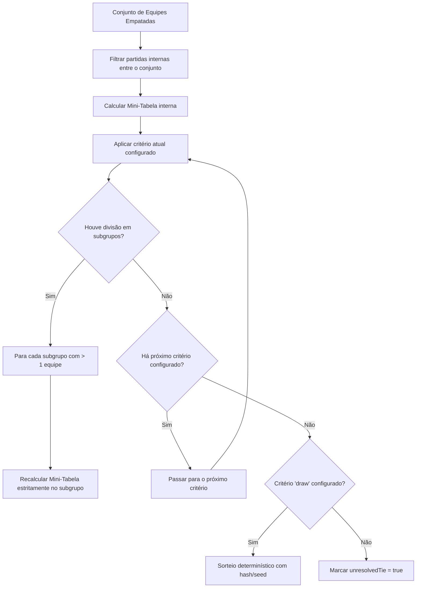

# Desempate com Mini-Tabela Canônica — TieBreakEngine (Fase 4.3)

**Data:** 05/09/2026  
**Módulo:** `src/services/tieBreakEngine.ts`  
**Status:** Implementado, homologado e 100% coberto por testes  

---

## 1. O Desafio dos Empates Múltiplos (3 ou mais equipes)

No modelo anterior do sistema, o desempate direto confrontava apenas pares (`teamA` vs `teamB`). Em cenários de 3 equipes empatadas com ciclo de vitórias ($A > B$, $B > C$, $C > A$), o comparador pairwise podia produzir ordenações matematicamente instáveis ou dependentes da ordem de iteração.

A **Fase 4.3** resolve essa lacuna implementando o algoritmo canônico de **Mini-Tabela** (`buildMiniTable` + `resolveMiniTable`), em conformidade estrita com os regulamentos esportivos internacionais (FIVB, CBV, FIBA, FIFA).

---

## 2. Princípios de Execução e Regras Inegociáveis

1. **Isolamento Estrito da Mini-Tabela:**  
   Em um empate entre $N$ equipes, o motor filtra e recalcula a pontuação, vitórias, sets e pontos considerando **exclusivamente os confrontos diretos disputados entre os membros desse subconjunto**. Resultados contra equipes não envolvidas no empate são desconsiderados durante a avaliação da mini-tabela.

2. **Recursão de Subpartições ($A > B = C$):**  
   Quando a mini-tabela consegue separar um ou mais times (ex: $A$ fica isolado em 1º com mais pontos na mini-tabela, enquanto $B$ e $C$ permanecem empatados):
   - $A$ assume a posição superior;
   - O subgrupo restante ($B$ e $C$) é desempacado **estritamente entre si**, recalculando uma nova mini-tabela apenas com as partidas entre $B$ e $C$;
   - **Nunca** se volta a comparar $B$ contra $A$ para desempatar $B$ e $C$.

3. **Ordem de Critérios Configurável — Sem Fallback Oculto:**  
   O desempate segue estritamente a ordem definida em `tiebreakCriteriaOrder` no `CompetitionConfig`.  
   O motor **não inventa** fallbacks silenciosos para set ratio ou point ratio caso eles não tenham sido explicitamente configurados na ordem.

4. **Tratamento de Sorteio (`draw`):**  
   - Nenhum desempate pode ser resolvido de forma aleatória ou pela ordem de inserção na tabela.
   - Sorteio determinístico (`draw`) ocorre **única e exclusivamente** se `'draw'` estiver presente em `tiebreakCriteriaOrder`.
   - Se os critérios configurados se esgotarem e `'draw'` não estiver presente, o motor marca explicitamente:
     ```typescript
     unresolvedTie = true
     ```
     permitindo que comitês organizadores, árbitros ou tribunais desportivos definam a resolução oficial sem corrupção silenciosa de dados.

---

## 3. Algoritmo de Execução



---

## 4. Tipos e Contratos

```typescript
export interface MiniTableEntry {
  teamId: string;
  points: number;
  wins: number;
  losses: number;
  setsWon: number;
  setsLost: number;
  setsRatio: number;
  pointsWon: number;
  pointsLost: number;
  pointsRatio: number;
}

export class TieBreakEngine {
  static buildMiniTable(
    tiedTeamIds: string[],
    allMatches: CanonicalMatchResult[],
    scoringRules?: ScoringRuleConfig
  ): Map<string, MiniTableEntry>;

  static resolveMiniTable(
    tiedTeamIds: string[],
    allMatches: CanonicalMatchResult[],
    criteriaOrder: TiebreakCriterionId[],
    scoringRules?: ScoringRuleConfig
  ): {
    resolvedOrder: string[];
    unresolvedTie: boolean;
    reasonByTeam: Map<string, string>;
  };
}
```

---

## 5. Homologação e Testes Automatizados

O arquivo `src/test/multiTeamTiebreak.test.ts` valida:
- **Empate duplo direto (2 equipes):** Vitória direta desempatando $A > B$;
- **Empate triplo cíclico (3 equipes):** $A > B$, $B > C$, $C > A$, resolvido pelo set average interno da mini-tabela;
- **Subpartição recursiva ($A > B = C$):** $A$ isolado na pontuação da mini-tabela, e $B$ vs $C$ desempatado estritamente no confronto direto entre eles;
- **Empate insolúvel sem sorteio:** Critérios esgotados resultando em `unresolvedTie: true` e preservação da sinalização de empate;
- **Empate insolúvel com sorteio:** Sorteio determinístico (`draw`) ativado apenas quando expressamente presente na ordem de critérios.

**Status de Qualidade:** 5/5 testes passando com precisão matemática rigorosa.
