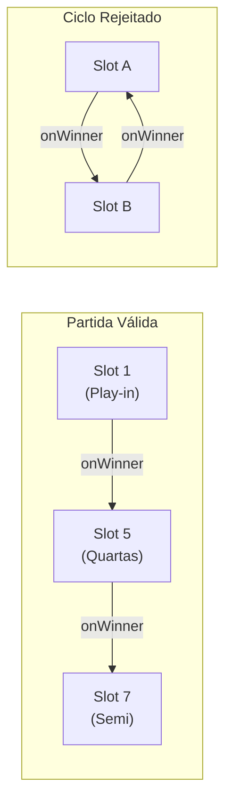

# Arquitetura do Motor de Progressão — Progression Engine (Fase 4.4 — Revisão Definitiva)

**Data:** 05/09/2026  
**Fase:** 4.4 — Ajustes Obrigatórios Pós-Auditoria  
**Status:** ARQUITETURA REVISADA E APROVADA  

---

## 1. O Princípio Central da Progressão Desacoplada

O **Progression Engine** é o subsistema responsável por propagar equipes qualificadas através das rodadas e estágios de uma competição.

### Regra de Ouro (Seção 10 do Regulamento Arquitetural):
> **A PROGRESSION ENGINE NÃO DEVE RESOLVER RESULTADOS NOVAMENTE.**  
> O motor **não calcula sets, não avalia parciais e não decide vencedores**.  
> Ele consome estritamente o `CanonicalMatchResult` produzido pelo `CompetitionRulesService`.  
> Se o resultado oficial indicar `winnerId = "team-47"`, o Progression Engine limita-se a encaminhar `"team-47"` para o `MatchSlot` de destino configurado.

```text
Oficialização / Homologação da Súmula
                 │
                 ▼
        CanonicalMatchResult
                 │
                 ▼
         Progression Engine
                 │
                 ▼
       Participant Resolution
                 │
                 ▼
          Next MatchSlot
```

---

## 2. Roteamento por Identidade Estável (Adeus a `quartas[0]`)

A auditoria comprovou que o código legado utilizava índices acidentais de array:
```typescript
// ANTIPADRÃO LEGADO (ELIMINADO)
const { winnerId: q1Winner } = getCanonicalWinnerAndLoser(quartas[0]);
semis[0].teamAId = q1Winner;
```
Na nova arquitetura, o roteamento opera exclusivamente com **Identidades Estáveis (`slotId`)**:

```typescript
export interface ProgressionRoute {
  /** Slot de origem da partida */
  sourceSlotId: string;
  /** Para onde vai o vencedor oficial */
  onWinner: {
    targetStageId: string;
    targetRoundId: string;
    targetSlotId: string;
    targetSide: 'home' | 'away' | 'teamA' | 'teamB';
  };
  /** Para onde vai o perdedor oficial (ex: Disputa de 3º Lugar) */
  onLoser?: {
    targetStageId: string;
    targetRoundId: string;
    targetSlotId: string;
    targetSide: 'home' | 'away' | 'teamA' | 'teamB';
  };
}
```

---

## 3. Validação do Grafo de Progressão e Detecção de Ciclos

A progressão entre slots e estágios forma uma rede direcionada. O motor inclui a função pura de validação `validateProgressionGraph(routes, stages)`:



### Regras de Validação:
1. **Rejeição de Ciclo Direto ($A \to A$):** Um slot não pode apontar seu vencedor ou perdedor para si mesmo;
2. **Rejeição de Ciclo Indireto ($A \to B \to A$):** Vencedor de $A$ vai para $B$, e vencedor de $B$ vai para $A$;
3. **Rejeição de Ciclo Complexo ($A \to B \to C \dots \to A$):** Algoritmo de busca em profundidade (DFS) com detecção de nó cinza (back-edge) rejeita qualquer cadeia cíclica;
4. **Sem Destinos Órfãos:** Todo `targetSlotId` deve existir na definição do estágio correspondente;
5. **Sem Colisão de Lados:** Dois vencedores não podem ter como destino o mesmo lado (`targetSide: 'home'`) do mesmo slot.

---

## 4. Referências Abstratas de Vencedor e Perdedor

Eliminam-se todas as abstrações específicas como `quarterfinal1Winner` ou `semiFinal2Loser`.  
As referências são instâncias universais do contrato `ParticipantReference`:
- `{ type: 'match-winner', sourceStageId: 'stage-play-in', targetSlotId: 'slot-pi-1' }`
- `{ type: 'match-loser', sourceStageId: 'stage-semifinals', targetSlotId: 'slot-sf-2' }`

Isso permite representar:
- Grande Final (Vencedor Semi 1 vs Vencedor Semi 2);
- Disputa de 3º Lugar (Perdedor Semi 1 vs Perdedor Semi 2);
- Disputas de 5º e 7º Lugar (Perdedores das Quartas);
- Repescagens e chaves preliminares sem criar exceções no código.

---

## 5. Tratamento de BYE na Progressão

Quando um confronto possui um participante com `feed: { type: 'bye' }`:
1. O adversário é declarado **qualificado por avanço automático**;
2. Nenhuma partida é disputada;
3. O `ProgressionEngine` roteia imediatamente o participante qualificado para o `targetSlotId` subsequente;
4. Isso assegura que cabeças de chave ou equipes beneficiadas por chaves ímpares avancem deterministicamente.

---

## 6. DECISÕES ARQUITETURAIS APÓS REVISÃO

1. **Participante pendente não é equipe fictícia:** Nenhuma equipe falsa é inserida na base.
2. **MatchSlot é diferente de Match persistido:** O slot define o pareamento conceitual da chave.
3. **Stage possui identidade estável:** `stageId` único e auditável.
4. **Round possui identidade estável:** `roundId` único dentro do estágio.
5. **Progression utiliza referências declarativas:** Feeds e rotas apontam para `targetSlotId`.
6. **Progression é um DAG validável:** Grafo direcionado acíclico testado contra ciclos.
7. **Competition Lifecycle é diferente de Stage Runtime:** Status macro e micro operam separadamente.
8. **`group_name` não deve carregar sozinho Stage/Round/Group:** Desacoplamento de conceitos.
9. **Pairing não decide vencedor:** Emparelhamento apenas monta confrontos.
10. **Progression não recalcula resultado:** Consumo canônico de `CanonicalMatchResult`.
11. **BYE não é equipe:** É folga automática resolvida no chaveamento.
12. **Nenhum formato específico de campeonato será embutido:** Universalidade do motor.
