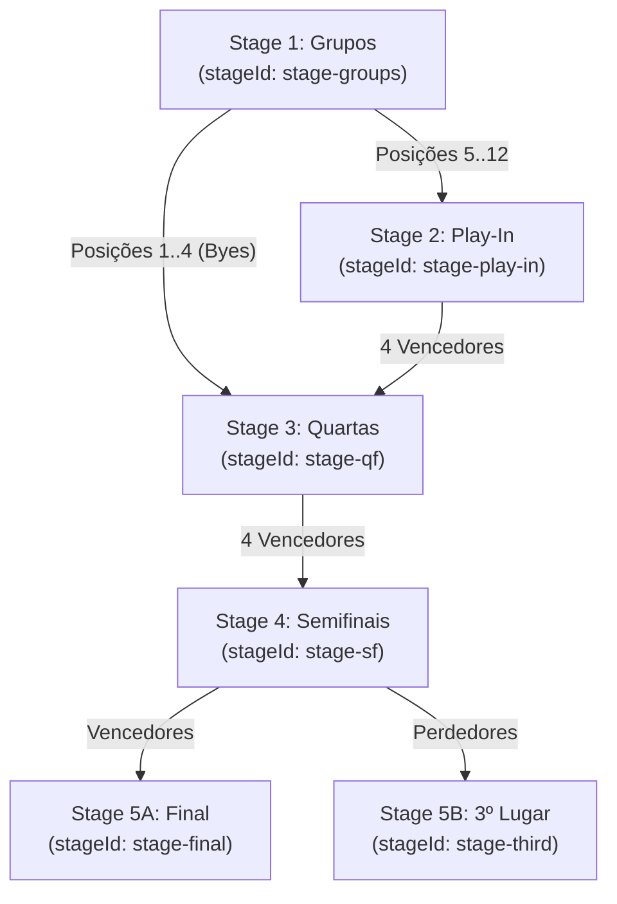

# Arquitetura do Motor de Estágios — Stage Engine (Fase 4.4 — Revisão Definitiva)

**Data:** 05/09/2026  
**Fase:** 4.4 — Ajustes Obrigatórios Pós-Auditoria  
**Status:** ARQUITETURA REVISADA E APROVADA  

---

## 1. O Que É um Stage no BaseOS?

No BaseOS, um **Stage (Estágio / Fase)** é uma unidade autônoma e delimitada de disputa esportiva dentro de uma competição. Cada estágio possui:
1. **Identidade Estável (`stageId`):** Identificador imutável (ex: `'groups-stage'`, `'play-in-stage'`, `'quarterfinals'`, `'semifinals'`, `'finals'`);
2. **Ordem Sequencial (`order`):** Posição ordinal no torneio ($1, 2, 3 \dots$);
3. **Relações de Dependência no Grafo (`dependsOnStageIds`):** Lista explícita de estágios antecedentes que devem ser homologados antes de liberar a resolução de feeds deste estágio;
4. **Alimentadores de Participantes (`participantFeeds`):** Origem declarativa dos competidores;
5. **Regras de Pareamento (`pairingConfig`):** Método matemático de organização dos confrontos;
6. **Sobrescritas Esportivas Locais:** Formato de sets específico para a fase (`matchRulesOverride`);
7. **Critérios de Conclusão Determinísticos:** Um estágio só atinge `status: 'completed'` quando 100% de seus confrontos previstos estiverem finalizados e homologados via `CanonicalMatchResult`.

---

## 2. Configuração vs Runtime: Onde Cada Conceito Reside?

Para garantir coerência sem duplicar fontes de verdade, o modelo divide claramente configuração e execução:

```text
CompetitionConfig (SSOT Central)
       │
       ▼
StageDefinition (Configuração Declarativa)
  ├── stageId, order, name, type
  ├── dependsOnStageIds
  ├── groupConfig / eliminationConfig
  ├── participantFeeds
  └── pairingConfig
       │
       ▼
StageEngine (Motor Puro de Interpretação)
       │
       ▼
StageRuntimeState (Estado Dinâmico de Execução)
  ├── stageId
  ├── status: 'pending' | 'ready' | 'in-progress' | 'completed' | 'blocked'
  ├── rounds: RoundRuntimeState[]
  │      └── roundId, order, matchSlots: MatchSlotState[]
  ├── resolvedParticipantCount
  ├── completedMatchesCount / totalMatchesCount
  └── isCompleted
```

### Regras de Coexistência:
1. **Configuração é Imutável:** Reside exclusivamente dentro de `CompetitionConfig.format.stages` (congelada pelo `rulesSnapshot` quando os jogos iniciam).
2. **Runtime é Derivado:** O estado do estágio é calculado deterministicamente pelo `StageEngine` em memória, combinando a definição do estágio com os `MatchRecords` e `CanonicalMatchResults` oficiais.
3. **Sem Duplicidade de SSOT:** Não existe uma tabela intermediária que concorra com o `CompetitionConfig`.

---

## 3. Identidades Estáveis em Toda a Hierarquia

A arquitetura elimina terminantemente qualquer dependência de índices de array (`array[0]`, `array[1]`) ou da ordem acidental de retorno das queries do banco de dados:

```text
Stage (stageId: "stage-knockout")
  │
  ├── Round (roundId: "round-qf", order: 1, label: "Quartas de Final")
  │     ├── MatchSlot (slotId: "slot-qf-1")
  │     ├── MatchSlot (slotId: "slot-qf-2")
  │     ├── MatchSlot (slotId: "slot-qf-3")
  │     └── MatchSlot (slotId: "slot-qf-4")
  │
  └── Round (roundId: "round-sf", order: 2, label: "Semifinais")
        ├── MatchSlot (slotId: "slot-sf-1")
        └── MatchSlot (slotId: "slot-sf-2")
```

Cada slot, rodada e estágio possui ID único e determinístico gerado no formato canônico:
- `stageId`: `stage-<tipo>-<ordem>` (ou slug customizado definido na config);
- `roundId`: `round-<stageId>-<ordem>`;
- `slotId`: `slot-<stageId>-<roundId>-<numero>`.

---

## 4. O Grafo Direcionado Acíclico (DAG) e Validação de Ciclos

Para garantir a integridade esportiva, o conjunto de estágios é tratado como um **Grafo Direcionado Acíclico (DAG)**.



### Validação Formal do Grafo (`validateStageGraph`):
O motor executa uma verificação prévia obrigatória antes de aceitar qualquer configuração:
1. **Detecção de Ciclo Direto ($A \to A$):** Um estágio não pode depender de si mesmo.
2. **Detecção de Ciclo Indireto ($A \to B \to A$):** Dependências mútuas são rejeitadas.
3. **Detecção de Ciclos Complexos ($A \to B \to C \to A$):** Algoritmo de coloração de nós em DFS (Depth-First Search) percorre todas as arestas de dependência e de feeds para provar aciclicidade.
4. **Consistência de Ordem Topológica:** Para toda dependência $A \to B$, deve valer $\text{order}(A) < \text{order}(B)$.
5. **Divisibilidade de Participantes:** Verifica se a soma dos participantes providos pelos feeds de entrada é compatível com o método de emparelhamento configurado.

---

## 5. Separação: Competition Lifecycle vs Stage Runtime

| Escopo | Entidade | Estados Suportados | Propósito |
| :--- | :--- | :--- | :--- |
| **Macro** | `CompetitionLifecycleStatus` | `draft`, `registration-open`, `registration-closed`, `draw-pending`, `groups-defined`, `in-progress`, `playoffs`, `completed`, `cancelled` | Controla a governança geral da competição (inscrições, sorteio geral, homologação do campeão). |
| **Micro** | `StageRuntimeStatus` | `pending`, `ready`, `in-progress`, `completed`, `blocked` | Controla o andamento de uma fase interna sem poluir a tabela `competitions` com dezenas de status intermediários. |

### Significado dos Estados do Stage:
- **`pending`:** Aguardando conclusão dos estágios antecedentes dos quais depende;
- **`ready`:** Estágios antecedentes concluídos; pronto para resolver participantes e gerar confrontos;
- **`in-progress`:** Partidas geradas e em disputa (pelo menos uma partida agendada ou iniciada);
- **`completed`:** 100% das partidas do estágio finalizadas e homologadas;
- **`blocked`:** Inconsistência detectada (ex: empate insolúvel na fase de grupos que bloqueia a montagem do play-in até resolução manual).

---

## 6. Catálogo de Erros Determinísticos do Domínio

O `StageEngine` nunca emite falhas silenciosas nem retorna listas truncadas sem explicação. Erros esportivos e estruturais são modelados formalmente:

```typescript
export type StageEngineErrorCode =
  | 'INVALID_STAGE_GRAPH'        // Grafo com referências inexistentes
  | 'CYCLIC_PROGRESSION'          // Ciclo detectado nas dependências ou feeds
  | 'MISSING_PARTICIPANT_FEED'    // Slot sem origem declarada
  | 'INVALID_PAIRING'             // Método de emparelhamento incompatível com a contagem de times
  | 'INSUFFICIENT_PARTICIPANTS'   // Menos equipes que o mínimo exigido pela chave
  | 'UNRESOLVED_PARTICIPANT'      // Tentativa de iniciar partida sem participante resolvido
  | 'DUPLICATE_SLOT'              // Colisão de identificadores de slot
  | 'STAGE_BLOCKED_BY_TIE';       // Empate insolúvel no estágio anterior bloqueando avanço
```

---

## 7. DECISÕES ARQUITETURAIS APÓS REVISÃO

1. **Participante pendente não é equipe fictícia:** Proibido cadastrar times falsos no banco.
2. **MatchSlot é diferente de Match persistido:** Slot é conceito do domínio; Match é entidade de agendamento/súmula.
3. **Stage possui identidade estável:** `stageId` único em todo o ciclo de vida.
4. **Round possui identidade estável:** `roundId` único dentro do estágio.
5. **Progression utiliza referências declarativas:** Mapeia `matchId` para `targetSlotId`.
6. **Progression é um DAG validável:** Grafo acíclico com detecção DFS de ciclos.
7. **Competition Lifecycle é diferente de Stage Runtime:** Status macro e micro operam em planos separados.
8. **`group_name` não deve carregar sozinho Stage/Round/Group:** Desacoplamento estrutural em andamento.
9. **Pairing não decide vencedor:** Emparelhamento apenas monta confrontos.
10. **Progression não recalcula resultado:** Consumo estrito do `CanonicalMatchResult`.
11. **BYE não é equipe:** É folga regulamentar com avanço automático.
12. **Nenhum formato específico de campeonato será embutido:** O motor interpreta regras declarativas universais.
