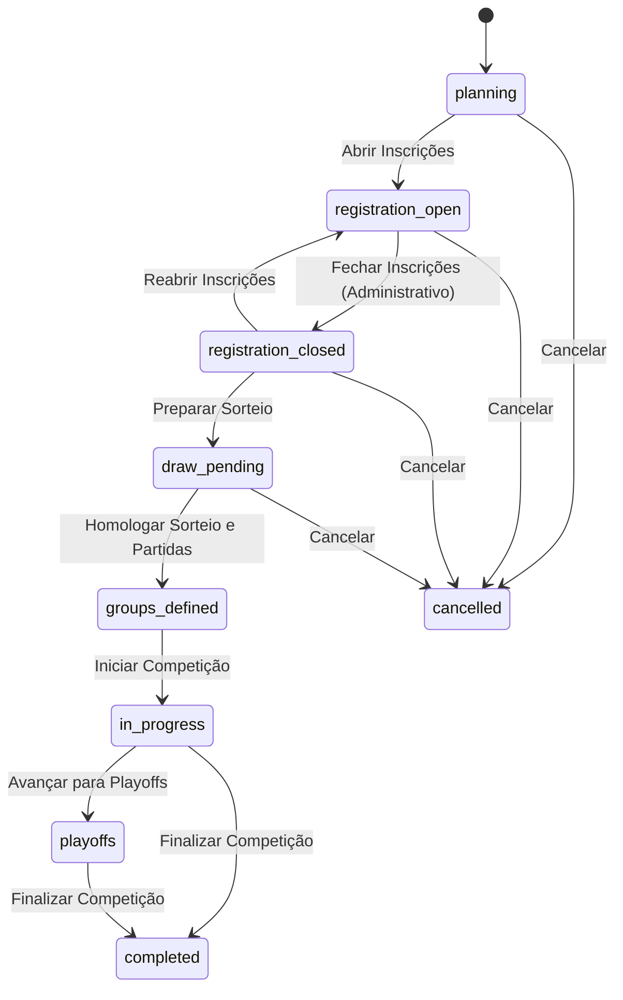

# BASEOS — INTEGRIDADE DE LIFECYCLE

**Data:** 05/09/2026  
**Sistema:** BaseOS  
**Módulo:** Gestão de Ciclo de Vida da Competição  

---

## 1. Visão Geral

O ciclo de vida de uma competição no BaseOS é gerenciado de forma centralizada pelo serviço [`src/services/competitionLifecycleService.ts`](file:///home/diego-martins/docker/volei/src/services/competitionLifecycleService.ts) e persistido na coluna `status` da tabela `competitions`.

A autoridade sobre transições de estado é estrita:
```text
UI (Páginas / Ações)
       ↓
CompetitionLifecycleService.validateTransition()
       ↓
dataAccess.updateCompetition(competitionId, { status: newStatus })
```

---

## 2. Estados Canônicos vs. Estados Legados

| Status Canônico | Enum DB (`competition_status`) | Descrição e Comportamento | Equivalente Legado |
|---|---|---|---|
| `planning` | Sim | Competição em planejamento e configuração inicial de regulamento. Inscrições fechadas. | `draft` |
| `registration-open` | Sim | Inscrições abertas para equipes e atletas. Portal liberado para submissão de elencos. | `registration` |
| `registration-closed` | Sim | Inscrições encerradas administrativamente. Edição de elencos bloqueada. Aguardando conferência/sorteio. | — |
| `draw-pending` | Sim | Período de homologação das equipes inscritas e preparação do sorteio de chaves. | — |
| `groups-defined` | Sim | Sorteio oficial homologado e persistido com todas as partidas da fase de grupos geradas. | — |
| `in-progress` | Sim | Competição em andamento; partidas sendo disputadas e pontuações computadas. | — |
| `playoffs` | Sim | Fase eliminatória / mata-mata em andamento. | — |
| `completed` | Sim | Competição encerrada; classificação final consolidada e premiada. | — |
| `cancelled` | Sim | Competição cancelada administrativamente. | — |

---

## 3. Matriz de Transições Válidas



---

## 4. Desacoplamento Crítico: `registration-closed` NÃO SIGNIFICA `draw-ready`

### 4.1 Princípio Arquitetural
O ato de **encerrar inscrições** (`closeRegistrations`) é uma decisão puramente administrativa do organizador ou motivada pela expiração do prazo de cadastro.

- **Fechamento de Inscrições (`registration-closed`):**
  - Trava imediatamente mutações no portal de atletas e equipes (`isRegistrationLocked = true`).
  - Não exige número mínimo de equipes aptas nem restrições de sorteio (`groupsCount * 2`).
  - Permite que o organizador feche a competição mesmo com equipes pendentes ou insuficientes para análise de elegibilidade.

- **Prontidão de Sorteio (`Draw Readiness`):**
  - Avaliado exclusivamente por [`CompetitionDrawEligibilityService`](file:///home/diego-martins/docker/volei/src/services/competitionDrawEligibilityService.ts).
  - Exige que a competição esteja em `registration-closed` ou `draw-pending`.
  - Avalia o elenco mínimo e conformidade regulamentar de cada equipe individualmente.
  - Valida a restrição técnica do sorteio: equipes elegíveis $\ge \max(2, \text{groupsCount} \times 2)$ para permitir o chaveamento round-robin.

---

## 5. Bloqueio de Edição Pós-Fechamento

A função canônica [`isRegistrationLocked`](file:///home/diego-martins/docker/volei/src/services/registrationService.ts) protege todas as operações de mutação nos seguintes status:
- `planning` / `draft`
- `registration-closed`
- `draw-pending`
- `groups-defined`
- `in-progress`
- `playoffs`
- `completed`
- `cancelled`

Apenas `registration-open` (ou legado `registration`) permite submissão e alteração de elencos, desde que `is_locked = false` e a data limite (`registration_deadline`) não tenha expirado.
